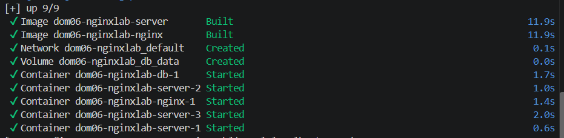
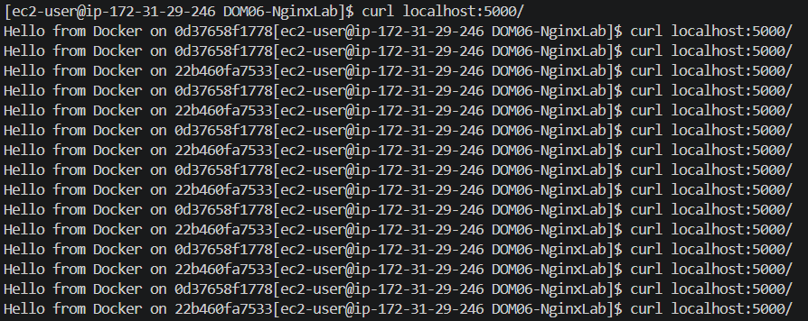
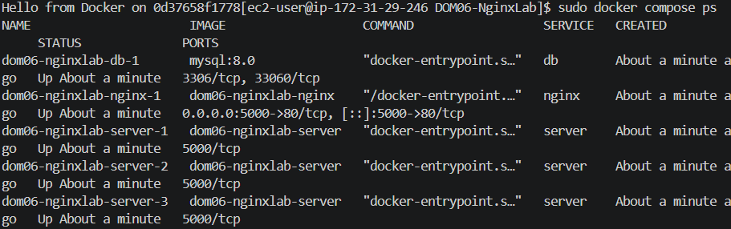
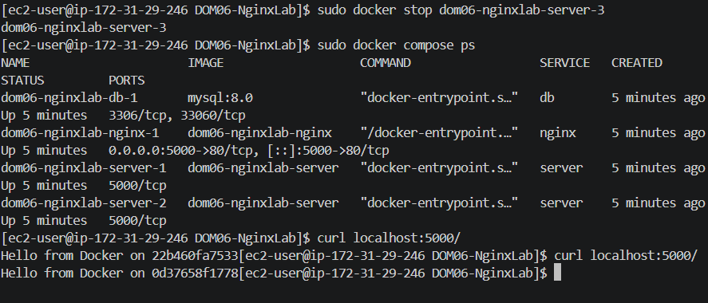

# DOM06-NginxLab

## Thyra - Reverse Proxy

This lab focused on setting up and configuring NGINX as a reverse proxy to route incoming traffic to an application service behind a single entry point.

### What was done
- Installed and configured NGINX for reverse proxy use
- Created the necessary server configuration to proxy requests to the backend service
- Set proxy headers so the application receives the correct client and request metadata
- Verified that traffic is correctly forwarded and the app is accessible through the proxy
- Simplified access to the service by using NGINX as the front-facing layer

### Outcome
The application is now served through NGINX, which acts as a reverse proxy and centralizes request handling, routing, and access to the backend service.

### Update

Here are the results of running this on an EC2

You can see the reverse proxy working as a load balancer

Here I have all three repicas

Here is the call to the server still working even though I killed one of the containers
